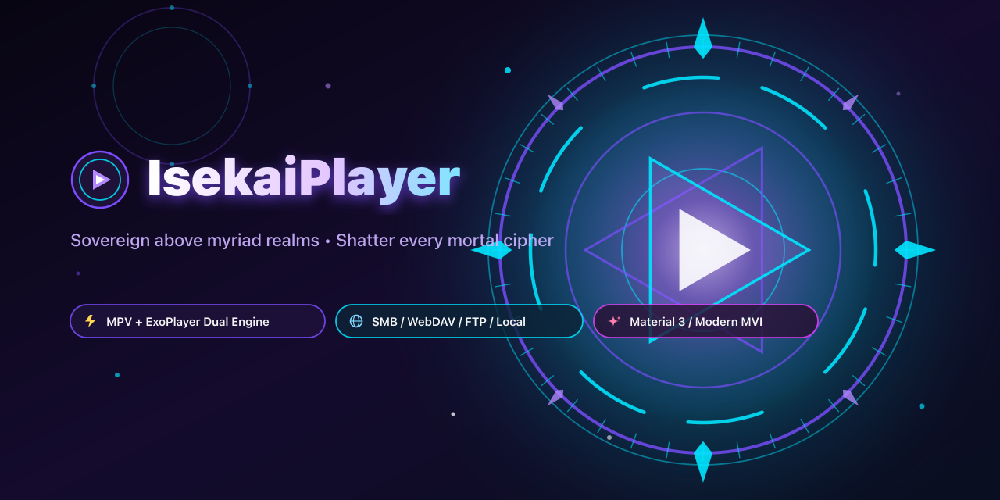
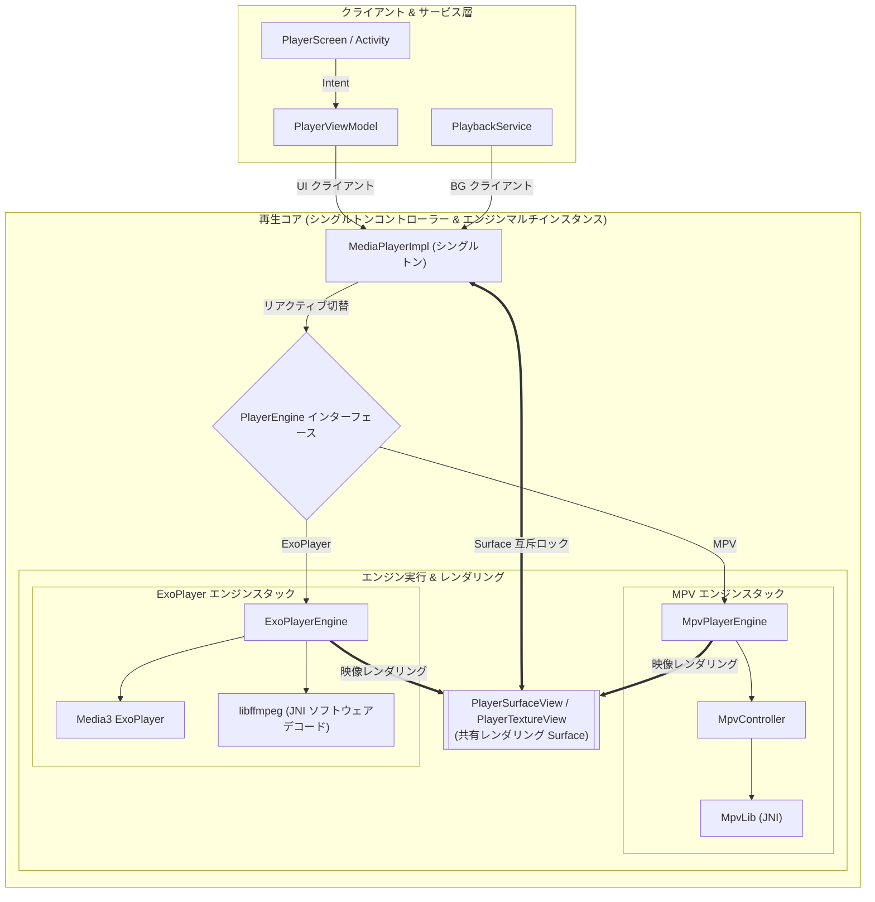

[English](README.md) | [简体中文](README_zh.md) | [繁體中文 (香港)](README_zh_HK.md) | [繁體中文 (台灣)](README_zh_TW.md) | **日本語** | [Русский](README_ru.md)



# IsekaiPlayer

[](https://play.google.com/store/apps/details?id=com.fiepi.media.app)
[](https://t.me/IsekaiPlayer)

[](https://github.com/onlymash/IsekaiPlayer/releases)
[](https://github.com/onlymash/IsekaiPlayer/releases)

> ### *Apocalypse Zero: Genesis Stream*
> 
> *「終末の黄昏よりも暗きもの、原初の刃よりも鋭きもの。  
> 諸界の構造の上に君臨し、あまねく暗号の封印を打ち砕け。  
> 見よ、この不断の奇跡の中に、再生せし原初世界の創世を！」*  
> 
> ***「——境界を超越せよ・ジェネシス・ストリーム、放て！」***

**IsekaiPlayer** は、ローカルストレージとリモートネットワークをシームレスに繋ぐために設計された、Android 向けの強力でモダンなメディアプレイヤーです。Jetpack Compose でゼロから構築されており、メディアの閲覧や再生に統一感のある洗練されたレスポンシブなインターフェースを提供します。

## 🚀 主な機能

*   **統合ソース管理**: ローカルストレージ、SMB (Samba)、FTP、WebDAV サーバーのメディアを一箇所でスムーズに閲覧・管理。
*   **デュアルエンジンアーキテクチャ**: 高機能な **mpv**（高度な字幕スタイル、ソフトウェア音量ゲイン、ビデオフィルター）と **ExoPlayer (Media3)**（ハードウェアデコード、高効率ストリーミング）の双方をサポートし、**再生中のシームレスなリアルタイム切替**に対応。
*   **アダプティブコントロール**: アクティブな再生エンジンがサポートする機能に応じて、UI コントロールが自動的に有効/無効化または非表示に切替。
*   **スムーズなパフォーマンス**: Jetpack Compose によるレスポンスの良いファイル閲覧とスムーズなナビゲーション。
*   **豊富なメタデータ**: ファイルサイズ、解像度、再生時間、更新日時が一目で確認可能。
*   **スマートサムネイル**: ローカル動画の高速プレビューと、リモートソースからの安全なフレーム抽出。
*   **リモート・ローカル外部字幕サポート**: ローカルおよびリモートサーバー（SMB、FTP、WebDAV）上の外部字幕ファイル（`.srt`, `.ass`, `.ssa`, `.vtt`, `.sub`）を自動スキャンし、動画ファイルとスマートに自動関連付け。
*   **カスタマイズ可能なプレイヤーレイアウト & 視覚効果**:
    *   **モジュール式コントロールレイアウト**: 画面の 4 隅のアクションボタンを自由に配置。インタラクティブなプレビュー機能と豊富なクイックアクション（PiP、スクリーンショット、再生速度、字幕/音声ディレイなど）を搭載。
    *   **グラスモフィズム UI 効果**: 背景ブラーや透明度の微調整が可能な高品位なビジュアルスタイル。
*   **モダンなナビゲーション**: ディレクトリごとにスクロール位置を自動保持・復元する多層ブレッドクラムナビゲーション。
*   **カスタマイズ可能な表示設定**: 柔軟なソート機能と表示項目のカスタマイズ。設定は安全に永続化。
*   **高度なジェスチャー機能**: 音量、明るさ、シーク、再生速度を直感的に操作。
*   **Material 3 デザイン**: 最新の Android デザインガイドラインに準拠したクリーンで適応性の高い UI。

## 🛠 技術スタック

*   **最小要件**: Android 13 (API 33)
*   **UI**: Jetpack Compose (Material 3)
*   **ナビゲーション**: Navigation3
*   **依存関係注入**: Koin
*   **再生エンジン**:
    *   **mpv**: Vulkan/OpenGL 対応のカスタム JNI バインディング
    *   **ExoPlayer (Media3)**: OkHttp ストリーミングおよびキャッシュ統合
*   **画像読み込み**: Coil 3
*   **ネットワークプロトコル**: WebDAV, SMB, FTP
*   **永続化**: DataStore & Room
*   **言語**: Kotlin

## 📂 プロジェクト構造

関心事の分離を徹底し、ビルドパフォーマンスを向上させるため、マルチモジュール設計を採用しています：

*   **`:app`**: UI および統合層。Compose 画面、ViewModel、設定サブページ、全体的な DI 設定を含みます。
*   **`:domain`**: **純粋な Kotlin JVM** モジュール。コアビジネスロジック、エンティティ、リポジトリインターフェース、ユースケース、再生状態の抽象化を保持。Android フレームワークへの依存はゼロです。
*   **`:data`**: 永続化およびネットワーク層。リポジトリインターフェースを実装し、ローカル DB キャッシュと型安全な設定保存を管理します。
*   **`:player`**: 再生アダプターおよびレンダリング層。ドメインの抽象化を具体的な再生エンジンにブリッジし、ライフサイクル管理と共通のレンダリング Surface View を提供します。
*   **`:libmpv`**: **mpv** メディアプレイヤーエンジンの低レイヤー C/C++ JNI バインディングおよびネイティブコントローラー。
*   **`:libffmpeg`**: ExoPlayer (Media3) 用の低レイヤー C/C++ JNI バインディングおよび FFmpeg ソフトウェア音声デコーダー。

## 🎬 再生アーキテクチャと設計原則

IsekaiPlayer は、マルチエンジン、マルチインスタンス並行性、高い安定性、デッドロック防止を備えた堅牢な動画再生アーキテクチャを採用しています。

### 1. レイヤーアーキテクチャ



### 2. コア設計原則

#### A. マルチエンジン & リアクティブ切替 (Multi-Engine & Hot-Switching)
*   **シングルトンコントローラー**: `MediaPlayerImpl` がグローバルシングルトンとしてクライアントセッション、Surface 管理、エンジン切替を統一制御。
*   **エンジンマルチインスタンス隔離**: ネイティブエンジン（`MpvController` や `mpv_handle` など）の破棄処理は時間を要し非同期で実行されます。旧エンジンの破棄完了を待たずに即座にホットスワップを実現するため、ネイティブ層で**マルチインスタンス隔離**をサポート。新旧インスタンスの重複時のリソース競合を防止します。
*   **機能自適応**: エンジン機能の状態をリアクティブに公開し、現在選択されているエンジンでサポートされない UI 機能（OSD 統計やコマ送りなど）を自動で無効化/非表示化します。

#### B. Surface 所有権ミューテックス & 統一ビュー (Surface Ownership Mutex)
*   **背景**: Android の `Surface` は限られたハードウェアリソースです。エンジン切替や画面遷移時に複数のインスタンスが制御権を競合する可能性があります。
*   **解決策**: 専用の Surface ミューテックスにより Surface のアタッチ/デタッチ操作をシリアル化。統一された Surface View を全エンジンのレンダリングターゲットとして使用します。

#### C. クライアント参照カウント管理
*   **クライアント分類**:
    *   **UI クライアント**: 映像レンダリングを行う画面セッション。
    *   **バックグラウンドクライアント**: 音声の継続再生を行うメディアサービスセッション。
*   **動作ロジック**: 全ての UI クライアントが離脱した際、即座に Surface を解放し映像描画を停止。UI およびバックグラウンドの全カウントが 0 になった時のみ、ネイティブエンジンを安全に破棄します。

#### D. ネイティブの安全性とスレッド排他制御 (Native Safety)
*   **課題**: 描画処理中にネイティブエンジンの破棄やリセットを行うとスレッド競合やクラッシュの原因となります。
*   **安全性**: API 呼び出しの厳密なスレッド同期と、エンジンの同期デタッチシーケンスにより、画面遷移やエンジン切替時のクラッシュやメモリリークを防止します。

## 🛠 ネイティブライブラリのビルド

ビルド脚本の詳しいオプションと使い方については、[scripts/README.md](scripts/README.md) を参照してください。

1.  **外部ソースコードのダウンロードと同期**:
    mpv およびその依存関係（ffmpeg 等）のソースコードを取得・更新します：
    ```bash
    ./scripts/sync-sources.sh
    ```

2.  **ネイティブライブラリのコンパイル**:
    サポートされている ABI 向けにライブラリをビルドします：
    ```bash
    ./scripts/build-native.sh
    ```

## 🚧 プロジェクトの進捗状況

*   [x] 統合メディアブラウザ (ローカル, SMB, FTP, WebDAV)
*   [x] デュアル再生エンジンサポート (mpv & ExoPlayer/Media3)
*   [x] リアクティブなエンジン切替 & 機能自適応
*   [x] 基本的な再生コントロール & ジェスチャー
*   [x] プレイリスト管理
*   [x] 高度な字幕/音声トラック選択
*   [x] リモートソースの外部字幕自動検出 & 関連付け (SMB, FTP, WebDAV)
*   [x] カスタマイズ可能なレイアウト & グラスモフィズム UI 効果

## 🙏 謝辞

*   **[mpv-android](https://github.com/mpv-android/mpv-android)**: Android 向け `libmpv` ビルドスクリプトおよび設定パラメータの基礎を提供していただいたことに感謝いたします。
*   **[mpvRex-libmpv](https://github.com/sfsakhawat999/mpvRex-libmpv)**: Vulkan 統合リファレンスおよび高性能シャープネスシェーダーの提供に感謝いたします。
*   **[AndroidX Media3](https://developer.android.com/media/media3)**: ExoPlayer および Compose レイアウトパターンを提供している Google Media3 チームに感謝いたします。

## 📄 ライセンス

IsekaiPlayer は [GNU General Public License v3.0 (GPLv3)](LICENSE) の下で公開されています。
