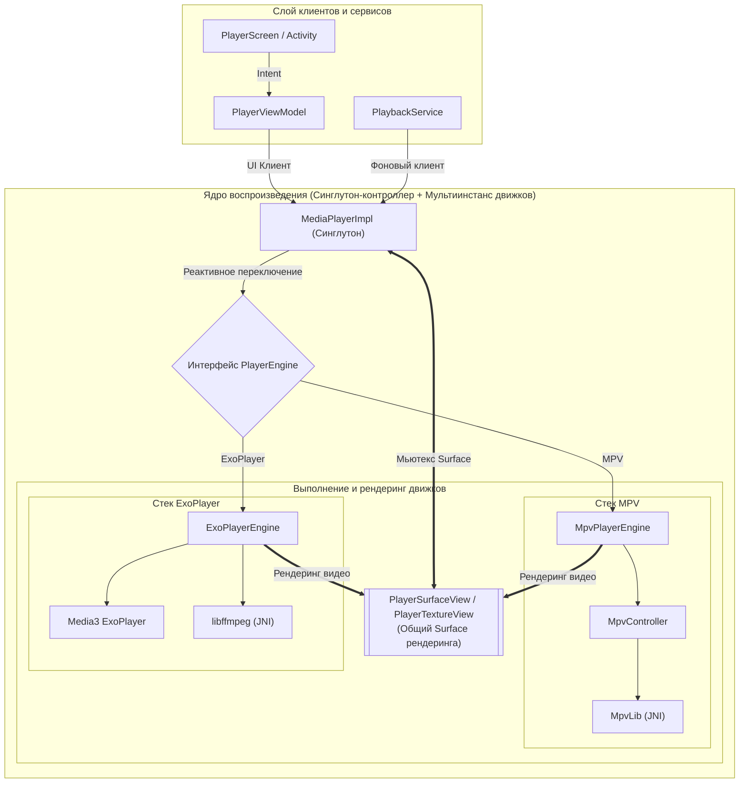

[English](README.md) | [简体中文](README_zh.md) | [繁體中文 (香港)](README_zh_HK.md) | [繁體中文 (台灣)](README_zh_TW.md) | [日本語](README_ja.md) | **Русский**


# IsekaiPlayer

[](https://play.google.com/store/apps/details?id=com.fiepi.media.app)
[](https://t.me/IsekaiPlayer)

[](https://github.com/onlymash/IsekaiPlayer/releases)
[](https://github.com/onlymash/IsekaiPlayer/releases)

> ### *Apocalypse Zero: Genesis Stream*
> 
> *«Темнее предсмертных сумерек, острее первозданного клинка.  
> Владычествуя над архитектурой бесчисленных миров, сокруши каждую смертную печать шифра.  
> Свидетельствуйте же в этом непрерывном чуде — рождение возрождённого первозданного мира!»*  
> 
> ***«— Превосходя горизонты: Genesis Stream, ВЫСВОБОДИТЬ!»***

**IsekaiPlayer** — это мощный современный медиаплеер для Android, созданный для объединения локального хранилища и удалённых сетевых ресурсов. Построенный с нуля на Jetpack Compose, он обеспечивает единый, отзывчивый и элегантный интерфейс для всех ваших потребностей в просмотре и воспроизведении медиафайлов.

## 🚀 Ключевые возможности

*   **Единое управление источниками**: Удобный просмотр и управление файлами из локального хранилища, серверов SMB (Samba), FTP и WebDAV в одном месте.
*   **Двухдвижковая архитектура**: Поддержка как **mpv** (богатый функционал, продвинутые стили субтитров, программное усиление звука и видеофильтры), так и **ExoPlayer (Media3)** (аппаратное декодирование, энергоэффективный стриминг) с **бесшовным переключением во время воспроизведения**.
*   **Адаптивное управление**: Элементы UI автоматически адаптируются (включаются, отключаются или скрываются) в зависимости от возможностей активного движка.
*   **Высокая производительность**: Быстрый просмотр файлов и плавная навигация на базе Jetpack Compose.
*   **Богатые метаданные**: Мгновенный просмотр размера файла, разрешения видео, длительности и даты изменения.
*   **Умные эскизы**: Быстрая генерация миниатюр для локальных видео и безопасное извлечение кадров для сетевых источников.
*   **Поддержка внешних субтитров**: Сканирование, автоматическое определение языка и умное сопоставление внешних файлов субтитров (`.srt`, `.ass`, `.ssa`, `.vtt`, `.sub`) для локальных и сетевых ресурсов (SMB, FTP, WebDAV).
*   **Настраиваемый макет плеера и визуальные эффекты**:
    *   **Модульный макет управления**: Свободная настройка кнопок действий по четырём углам экрана с интерактивным предпросмотром и широким набором быстрых действий (PiP, скриншот, скорость, задержка субтитров/аудио и т. д.).
    *   **Эффекты Glassmorphism**: Настраиваемое размытие фона, прозрачность и визуальный стиль для премиального внешнего вида.
*   **Современная навигация**: Многостековая навигация с автоматическим сохранением и восстановлением позиции прокрутки для каждой папки.
*   **Настраиваемые списки**: Гибкие параметры сортировки и видимости полей с надежным сохранением настроек.
*   **Продвинутые жесты**: Интуитивное управление громкостью, яркостью, перемоткой и скоростью воспроизведения.
*   **Дизайн Material 3**: Чистый, адаптивный интерфейс, соответствующий современным стандартам Android.

## 🛠 Технологический стек

*   **Минимальная версия**: Android 13 (API 33)
*   **Интерфейс**: Jetpack Compose (Material 3)
*   **Навигация**: Navigation3
*   **Внедрение зависимостей**: Koin
*   **Движки воспроизведения**:
    *   **mpv**: Кастомные JNI-привязки с поддержкой Vulkan/OpenGL
    *   **ExoPlayer (Media3)**: Интеграция со стримингом и кэшированием через OkHttp
*   **Загрузка изображений**: Coil 3
*   **Сетевые протоколы**: WebDAV, SMB, FTP
*   **Хранение данных**: DataStore & Room
*   **Язык**: Kotlin

## 📂 Структура проекта

Проект разделен на несколько модулей Gradle для четкого разделения ответственности и ускорения сборки:

*   **`:app`**: Слой UI и оркестрации. Содержит экраны Compose, ViewModel, подстраницы настроек и главную конфигурацию DI.
*   **`:domain`**: **Чистый Kotlin JVM** модуль. Содержит бизнес-логику, сущности, интерфейсы репозиториев, прецеденты использования и абстракции состояния воспроизведения. Не имеет зависимостей от Android SDK.
*   **`:data`**: Слой хранения и работы с сетью. Реализует интерфейсы репозиториев, управляет локальной БД и безопасно сохраняет настройки.
*   **`:player`**: Слой адаптера воспроизведения и рендеринга. Связывает абстракции domain с конкретными движками, управляет жизненным циклом и предоставляет универсальные Surface-представления.
*   **`:libmpv`**: Низкоуровневые C/C++ JNI-привязки и контроллер для движка **mpv**.
*   **`:libffmpeg`**: Низкоуровневые C/C++ JNI-привязки и программный декодер FFmpeg Audio для ExoPlayer (Media3).

## 🎬 Архитектура воспроизведения и принципы

IsekaiPlayer использует надежную многодвижковую архитектуру воспроизведения видео с поддержкой параллелизма, высокой стабильностью и защитой от гонки состояний.

### 1. Архитектура слоев



### 2. Ключевые принципы дизайна

#### A. Мультидвижок и реактивное переключение (Multi-Engine & Hot-Switching)
*   **Контроллер-синглтон**: `MediaPlayerImpl` выступает в роли глобального контроллера, координируя сессии клиентов, управление Surface и переключение движков.
*   **Мультиинстансная изоляция**: Освобождение нативных ресурсов (таких как `MpvController` / `mpv_handle`) занимает время и происходит асинхронно. Чтобы обеспечить мгновенное горячее переключение без ожидания завершения работы старого движка, нативный слой поддерживает полную изоляцию экземпляров.
*   **Адаптация возможностей**: Возможности движка передаются реактивно, позволяя UI автоматически отключать или скрывать недоступные функции (такие как статистика OSD или покадровый шаг назад).

#### B. Мьютекс владения Surface и универсальные View (Surface Ownership Mutex)
*   **Контекст**: Android `Surface` является критическим аппаратным ресурсом. При переключении движков или переходе между Activity несколько экземпляров могут конкурировать за управление им.
*   **Решение**: Выделенный мьютекс упорядочивает операции привязки и отвязки Surface. Универсальные Surface View служат единой целью рендеринга.

#### C. Подсчет ссылок с учетом типа клиента
*   **Категории клиентов**:
    *   **UI Клиенты**: Активные сессии интерфейса, отвечающие за рендеринг видео.
    *   **Фоновые Клиенты**: Сессии медиасервиса, отвечающие за непрерывное фоновое воспроизведение аудио.
*   **Логика**: При отсоединении всех UI-клиентов Surface освобождается, а рендеринг видео приостанавливается. Нативный экземпляр движка уничтожается только тогда, когда счетчик UI и фоновых клиентов равен нулю.

#### D. Безопасность нативного кода и синхронизация (Native Safety)
*   **Проблема**: Уничтожение нативных ресурсов или сброс плеера во время активного рендеринга может вызвать конфликты потоков или сбои.
*   **Безопасность**: Все изменения состояния и уничтожение движка следуют строгой последовательности синхронизации, исключая падения приложения и утечки памяти.

## 🛠 Сборка нативных библиотек

Подробные параметры и инструкции по использованию скриптов сборки см. в [scripts/README.md](scripts/README.md).

1.  **Загрузка и синхронизация исходного кода**:
    Выполните скрипт для загрузки или обновления исходного кода mpv и его зависимостей (ffmpeg и др.):
    ```bash
    ./scripts/sync-sources.sh
    ```

2.  **Компиляция нативных библиотек**:
    Запустите скрипт сборки для компиляции библиотек под поддерживаемые ABI:
    ```bash
    ./scripts/build-native.sh
    ```

## 🚧 Статус проекта

*   [x] Единый медиабраузер (Локальный, SMB, FTP, WebDAV)
*   [x] Поддержка двух движков воспроизведения (mpv & ExoPlayer/Media3)
*   [x] Реактивное горячее переключение движков и адаптация UI
*   [x] Базовое управление воспроизведением и жесты
*   [x] Управление плейлистами
*   [x] Продвинутый выбор субтитров и аудиодорожек
*   [x] Автоопределение и сопоставление внешних субтитров (SMB, FTP, WebDAV)
*   [x] Настраиваемый макет плеера и визуальные эффекты Glassmorphism

## 🙏 Благодарности

*   **[mpv-android](https://github.com/mpv-android/mpv-android)**: Спасибо за предоставление базовых скриптов сборки Android и параметров конфигурации для `libmpv`.
*   **[mpvRex-libmpv](https://github.com/sfsakhawat999/mpvRex-libmpv)**: Особая благодарность за примеры интеграции Vulkan и высокопроизводительные шейдеры резкости.
*   **[AndroidX Media3](https://developer.android.com/media/media3)**: Спасибо команде Google Media3 за ExoPlayer и шаблоны макетов Compose.

## 📄 Лицензия

IsekaiPlayer распространяется под лицензией [GNU General Public License v3.0 (GPLv3)](LICENSE).
