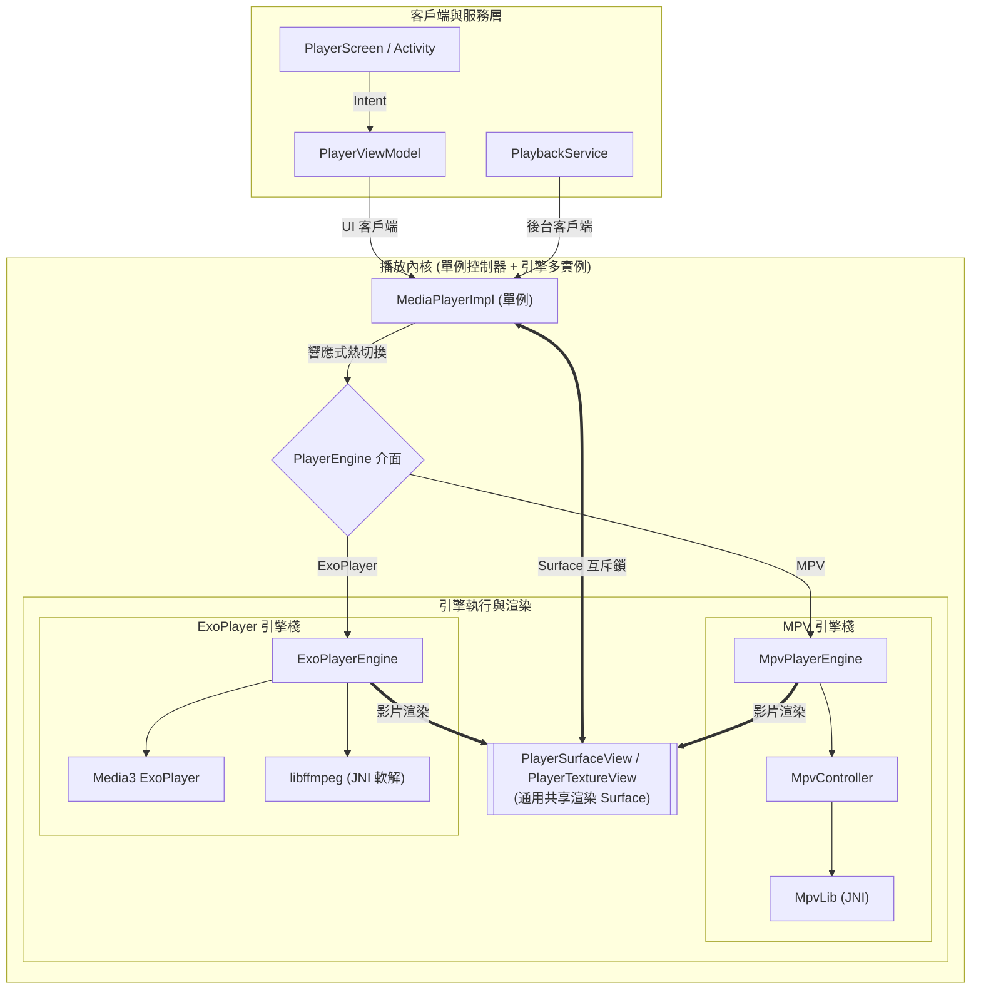

[English](README.md) | [简体中文](README_zh.md) | **繁體中文 (香港)** | [繁體中文 (台灣)](README_zh_TW.md) | [日本語](README_ja.md) | [Русский](README_ru.md)


# IsekaiPlayer

[](https://play.google.com/store/apps/details?id=com.fiepi.media.app)
[](https://t.me/IsekaiPlayer)

[](https://github.com/onlymash/IsekaiPlayer/releases)
[](https://github.com/onlymash/IsekaiPlayer/releases)

> ### 滅世真理・零式原初解構
> 
> *「比夜更黑的終末，比光更銳的權柄。  
> 凌駕於諸界架構之上，粉碎萬千編碼之重障。  
> 見證吧，在此無間斷的神跡之中，原初之世界重塑誕生——」*  
> 
> **「——超越境界・『零式原初解構』！」**

**IsekaiPlayer** 是一款專為 Android 打造的功能強大且現代的媒體播放器，採用 Jetpack Compose 從頭構建。它完美融合了本地儲存與多種遠端網絡協定，為您提供統一、靈敏且優雅的媒體瀏覽與播放體驗。

## 🚀 核心功能

*   **統一源管理**：在一个應用內無縫瀏覽和管理本地儲存、SMB (Samba)、FTP 和 WebDAV 伺服器。
*   **雙播放引擎架構**：同時支援 **mpv 引擎**（功能全能強勁，支援高級特效字幕、音軌軟增益及濾鏡）與 **ExoPlayer (Media3) 引擎**（原生硬解省電，網絡傳輸流暢），支援**播放中無縫切換引擎**。
*   **引擎能力自適應**：介面控制項會根據當前激活引擎所支援的功能自動智能聯動（如置灰禁用或隱藏不支援的操作）。
*   **絲滑效能**：基於 Jetpack Compose 構建，確保檔案列表滾動與導航輕盈流暢。
*   **豐富元數據**：檔案大小、影片解析度、時長、修改日期一目了然。
*   **智能縮圖**：本地影片極速預覽，遠端影片安全提取。
*   **遠端與本地外掛字幕識別**：全面支援各類常見外掛字幕格式（`.srt`, `.ass`, `.ssa`, `.vtt`, `.sub`）。無論本地還是遠端伺服器（SMB, FTP, WebDAV），都能自動掃描同目錄字幕並與同名影片智能關聯。
*   **自訂播放佈局與視覺特效**：
    *   **四角模組化佈局**：支援針對播放介面四個角落自由配置動作按鈕，提供即時可視化佈局預覽與豐富的快捷動作庫（畫中畫、截圖、倍速、字幕/音訊延遲等）。
    *   **毛玻璃視覺特效**：提供背景模糊與透明度微調等視覺效果，兼顧精緻感與流暢渲染。
*   **現代化導航**：支援多級麵包屑導航，並能自動恢復每個目錄的滾動位置。
*   **個性化檢視**：靈活的排序選項和顯示偏好，設定透過強類型儲存持久化。
*   **高級手勢**：直觀的音量、亮度、進度跳轉及倍速控制手勢。
*   **Material 3 設計**：遵循最新 Android 設計規範，介面簡潔優雅。

## 🛠 技術棧

*   **最低系統要求**：Android 13 (API 33)
*   **UI 框架**：Jetpack Compose (Material 3)
*   **導航**：Navigation3
*   **依賴注入**：Koin
*   **播放引擎**：
    *   **mpv**：支援 Vulkan/OpenGL 渲染的客製 JNI 引擎
    *   **ExoPlayer (Media3)**：整合高性能網絡傳輸與快取支援
*   **影像載入**：Coil 3
*   **網絡協定**：WebDAV, SMB, FTP
*   **持久化**：DataStore & Room
*   **程式語言**：Kotlin

## 📂 項目結構

項目採用了多 Gradle 模組化設計，以強制執行關注點分離並提升構建效能：

*   **`:app`**：UI 與編排層。包含 Compose 介面、介面狀態與互動邏輯、設定子頁面以及全域依賴注入的聚合配置。
*   **`:domain`**：**純 Kotlin JVM** 模組。包含核心業務邏輯、領域實體、倉庫介面、用例及播放狀態與引擎能力模型。完全脫離 Android 框架依賴。
*   **`:data`**：持久化與網絡層。實現倉庫介面，管理本地資料庫快取，並處理強類型的偏好設定持久化。
*   **`:player`**：媒體播放適配與渲染檢視層。負責將領域層的播放抽象橋接到具體的播放引擎，管理播放器生命週期，並提供通用的渲染檢視。
*   **`:libmpv`**：底層 C/C++ JNI 綁定以及針對 **mpv** 播放引擎的底層控制邏輯。
*   **`:libffmpeg`**：底層 C/C++ JNI 綁定以及為 ExoPlayer (Media3) 提供 FFmpeg 軟解碼支援。

## 🎬 播放架構與原理

本項目構建了一套支援多引擎（mpv + ExoPlayer）、多實例併發、具有高度穩定性且防競態的 Android 影片播放架構。

### 1. 邏輯分層圖



### 2. 核心設計原則

#### A. 多引擎架構與響應式熱切換 (Multi-Engine & Hot-Switching)
*   **單例控制器**：`MediaPlayerImpl` 作為全域單例播放控制器，統一調度客戶端引用計數、Surface 狀態及引擎切換。
*   **引擎多實例隔離**：原生引擎（如 `MpvController` / `mpv_handle`）的初始化與銷毀非常耗時且在後台異步執行。為了在切換引擎時無需等待舊引擎銷毀即可實現無縫熱切換，底層的原生引擎層支援完整的**多實例隔離**。這徹底避免了舊實例銷毀過程與新實例創建過程重疊時的資源競爭與卡頓。
*   **能力自適應**：UI 控制項響應當前引擎暴露的能力狀態，自動針對當前引擎（如 OSD 統計面板、逐幀倒退等）進行置灰禁用或隱藏。

#### B. Surface 歸屬權互斥與通用檢視 (Surface Ownership Mutex)
*   **背景**：Android `Surface` 是寶貴的硬件資源。在引擎切換或介面過渡時，新舊引擎可能會爭奪同一個 Surface 的控制權。
*   **方案**：在播放內核中引入專門的互斥鎖機制，對渲染 Surface 的綁定與解綁操作進行順序化排隊，防止資源爭用。同時採用通用的 Surface 渲染檢視作為統一的渲染承載目標。

#### C. 引用計數生命週期管理
*   **客戶端分類**：
    *   **前台 UI 客戶端**：負責影片渲染的介面會話。
    *   **後台服務客戶端**：負責音訊持續播放的媒體服務會話。
*   **行為邏輯**：當所有前台 UI 客戶端退出時，立即解綁 Surface 並暫停影片渲染；只有當所有前台與後台客戶端計數同時歸零時，才會真正銷毀底層引擎實例。

#### D. 線程安全與安全銷毀 (Native Safety)
*   **挑戰**：在處於渲染狀態時直接銷毀原生引擎句柄或重置播放器，容易引發線程競爭與崩潰。
*   **防崩潰**：播放引擎嚴格保障 API 調用的線程同步，原生引擎銷毀時執行嚴格的同步排空與解綁時序，確保在解綁渲染 Surface 或銷毀引擎句柄時不會觸發系統崩潰或記憶體洩漏。

## 🛠 編譯原生庫

詳細的構建腳本選項與使用指南，請參閱 [scripts/README_zh.md](scripts/README_zh.md)。

1.  **下載與同步外部源碼**：
    執行腳本以獲取或更新 mpv 及其依賴（ffmpeg 等）的源代碼：
    ```bash
    ./scripts/sync-sources.sh
    ```

2.  **編譯原生庫**：
    運行構建腳本為支援的 ABI 編譯庫檔案：
    ```bash
    ./scripts/build-native.sh
    ```

## 🚧 項目進度

*   [x] 統一媒體瀏覽器 (本地, SMB, FTP, WebDAV)
*   [x] 雙播放引擎架構 (整合 mpv 與 ExoPlayer/Media3)
*   [x] 響應式引擎熱切換與能力自適應
*   [x] 基礎播放控制與手勢
*   [x] 播放列表管理
*   [x] 高級字幕/音軌選擇
*   [x] 遠端資料源外掛字幕自動識別與關聯 (SMB, FTP, WebDAV)
*   [x] 自訂播放佈局與液態玻璃視覺特效

## 🙏 鳴謝

*   **[mpv-android](https://github.com/mpv-android/mpv-android)**：特別感謝該項目提供的基礎 `libmpv` Android 構建腳本與配置參數參考。
*   **[mpvRex-libmpv](https://github.com/sfsakhawat999/mpvRex-libmpv)**：特別感謝該項目提供的 Vulkan 整合參考以及高性能銳化著色器補丁。
*   **[AndroidX Media3](https://developer.android.com/media/media3)**：特別感謝 Google Media3 團隊提供的 ExoPlayer 播放庫與 Compose 檢視模式參考。

## 📄 開源許可證

IsekaiPlayer 採用 [GNU General Public License v3.0 (GPLv3)](LICENSE) 開源許可證。
